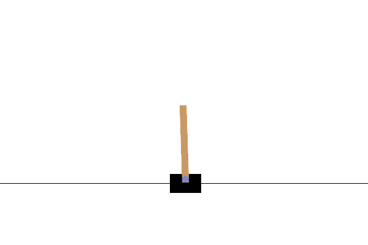

# Deep RL From Scratch: DQN, Double DQN and PPO

A short paragraph: what you built (RL algorithms in PyTorch and NumPy,
no RL libraries) and the main result.

## Results
Add results/algo_comparison.png and the summary table.

## What's implemented
- DQN: replay buffer, target network, epsilon-greedy
- Double DQN
- PPO: actor-critic, GAE, clipped objective

## How to run
pip install -r requirements.txt
python train.py
python train_ppo.py
python compare.py

## What I learned
Honest notes: what was unstable, what you fixed, what surprised you.
